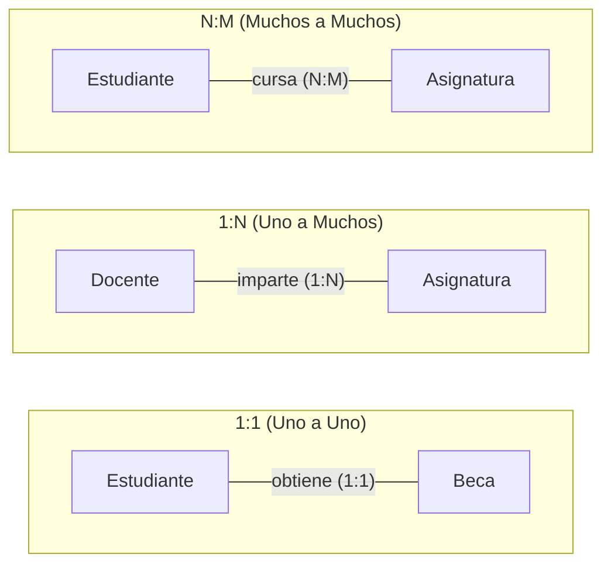

# Cardinalidad

## ¿Qué es?
La cardinalidad es el número de veces que una entidad aparece asociada a otra entidad. El mapeo de cardinalidad permite especificar la cantidad de entidades que podrán asociarse mediante una relación: expresa cuántas entidades de un extremo de la relación están relacionadas con cuántas del otro extremo. También se le conoce como **razón de cardinalidad**.

## Tipos de cardinalidad
1. **Una a una (1:1)**: una entidad se relaciona únicamente con otra y viceversa. Ejemplo: Estudiante – Beca; el Estudiante obtiene 1 Beca.
2. **Una a muchas (1:N)**: un registro de una entidad puede relacionarse con varios de otra entidad, pero en esta última existe solo una vez. Ejemplo: Docente – Asignatura; el Docente imparte muchas Asignaturas.
3. **Muchos a muchas (N:M)**: una entidad puede relacionarse con otra con ninguno o varios registros y viceversa. Ejemplo: Estudiante – Asignatura; los Estudiantes cursan una o varias Asignaturas.

## Contexto y Aplicación
La cardinalidad es un paso obligatorio durante la elaboración del diagrama Entidad-Relación ([[Elaborar un diagrama Entidad-Relación]]) y define cómo se traducirán las relaciones al [[Diseño lógico de la base de datos]]:
- Las relaciones **1:1** y **1:N** se resuelven propagando la clave primaria como clave foránea ([[Llaves primarias y foráneas]]).
- Las relaciones **N:M** requieren la creación de una tabla intermedia o asociativa en el esquema relacional.

## Relacionado con
- [[Modelo Entidad-Relación]]
- [[Elaborar un diagrama Entidad-Relación]]
- [[Diseño lógico de la base de datos]]
- [[Llaves primarias y foráneas]]
- [[00 - Unidad 1 - Modelado de la base de datos]]

## Lo que aún no sé
- Ninguno por el momento.
