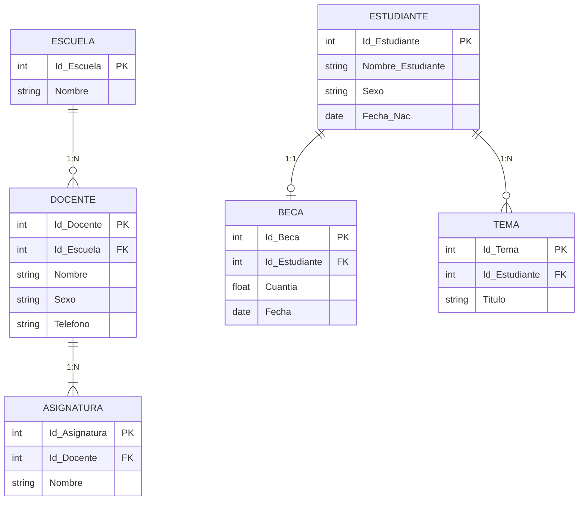

# Llaves primarias y foráneas

## ¿Qué es?
Las claves primarias y foráneas son los mecanismos de enlace estructurales del modelo relacional:

- **Clave Primaria (Primary Key o PK)**: Columna o combinación de columnas cuyos valores identifican de modo unívoco e irreductible cada registro de una tabla. No admite valores duplicados ni nulos (ver [[Ningún atributo de la clave primaria puede ser nulo]]).
- **Clave Foránea (Foreign Key o FK)**: Columna o conjunto de columnas en una tabla cuyos valores hacen referencia directa a la clave primaria de otra tabla (o de la misma tabla). Garantiza la integridad referencial de los vínculos (ver [[Las claves foráneas deben referenciar claves primarias válidas o ser nulas]]).

## Contexto y Aplicación
Al pasar del esquema conceptual Entidad/Relación al esquema lógico relacional, se deben añadir formalmente las **claves foráneas** necesarias para materializar las interrelaciones entre las entidades. Dichas claves foráneas **no aparecen representadas gráficamente en el diagrama E/R** original, sino que surgen durante la traducción relacional.

En el ejemplo del manual (base de datos **Escuela**), las relaciones se implementan mediante las siguientes conexiones de PK y FK:

## Relacionado con
- [[Restricciones de la base de datos]]
- [[Reglas de integridad y semántica de datos]]
- [[Ningún atributo de la clave primaria puede ser nulo]]
- [[Las claves foráneas deben referenciar claves primarias válidas o ser nulas]]
- [[Modelo Entidad-Relación]]
- [[Cardinalidad]]
- [[Diseño lógico de la base de datos]]
- [[Normalización de tablas]]
- [[Normalizar una estructura de datos hasta tercera forma normal]]
- [[00 - Unidad 1 - Modelado de la base de datos]]

## Lo que aún no sé
- Ninguno por el momento.
