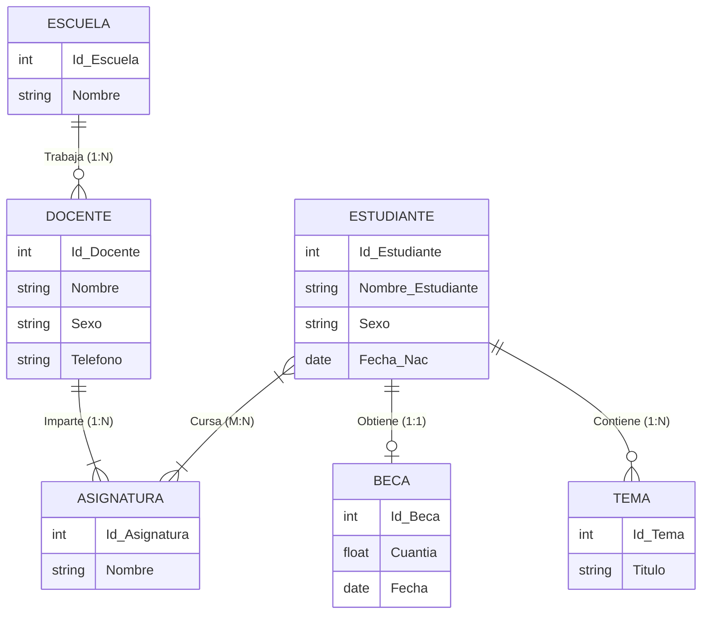

# Modelo Entidad-Relación

## ¿Qué es?
Es un tipo de diagrama de modelado conceptual que ilustra cómo las **entidades** (personas, objetos o conceptos) se relacionan entre sí dentro de un sistema.

Emplea un conjunto estandarizado de símbolos geométricos para representar la interconexión de entidades, relaciones y sus atributos. Refleja la estructura gramatical del lenguaje: utiliza entidades como sustantivos y relaciones como verbos.

Un diagrama Entidad-Relación (ER) posee tres tipos principales de elementos:
- **Entidades**: Unidades u objetos del mundo real de los que se almacena información.
- **Atributos**: Propiedades o características que describen y diferencian a las entidades.
- **Relaciones**: Vínculos lógicos y asociaciones entre dos o más entidades.

## Símbolos del diagrama ER

| Figura | Función |
|---|---|
| Rectángulo | Representa conjuntos de entidades |
| Elipse | Representa atributos |
| Rombo | Representa relaciones |
| Línea | Une atributos a entidades y entidades a relaciones |
| Elipse doble | Representa atributos multivaluados |
| Elipse discontinua | Denota atributos derivados |
| Línea doble | Indica participación total de una entidad en un conjunto de relaciones |
| Rectángulo doble | Representa conjuntos de entidades débiles |

## Contexto y Aplicación
El Modelo Entidad-Relación corresponde a la etapa de **diseño conceptual** en el ciclo de vida del modelado de datos. Sirve de puente de comunicación entre los requerimientos en lenguaje natural y la estructura lógica en tablas del SGBD.

Para plasmarlo operativamente en diagramas, ver [[Elaborar un diagrama Entidad-Relación]]. En el manual se presenta el modelo conceptual para la base de datos **Escuela**:

## Relacionado con
- [[Elaborar un diagrama Entidad-Relación]]
- [[Cardinalidad]]
- [[Diseño lógico de la base de datos]]
- [[Llaves primarias y foráneas]]
- [[00 - Unidad 1 - Modelado de la base de datos]]

## Lo que aún no sé
- Ninguno por el momento.
